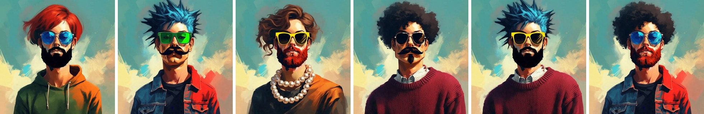

# Mix-and-Match: Generating Globally Coherent Images from Interchangeable Tiles

Shaham Zilber\*, Itay Hazan\*, Lior Wolf (\* equal contribution). Preprint, under review.

[Project page](https://itayhzn.github.io/mix-and-match/), with an interactive gallery of 178 libraries.



A *specification* gives a global prompt and *n* regions, each with *k* alternative regional prompts. Mix-and-Match
generates a *tile library* in one run of a pretrained text-to-image model: *k* tiles per region, plus one shared
region. Any combination of one tile per region assembles, at no further computation, into a complete and coherent
image, so a library of *k·n* tiles stands for *k^n* images. The six portraits above are six combinations of one
library of 4 regions with 4 alternatives each; its specification is [`configs/teaser_portrait.json`](configs/teaser_portrait.json).

The method needs no training. It changes only the attention mask, the prompts and the guidance of
[PixelDiT](https://github.com/NVlabs/PixelDiT), and it uses [SAM 3](https://huggingface.co/facebook/sam3) to find
the regions while the image is generated.

- [`generate.py`](generate.py) runs the method on specification files.
- [`combine.py`](combine.py) assembles combinations from a finished library.
- [`generate_baselines.py`](generate_baselines.py) runs the five baselines of the paper on the same backbone.
- [`configs/`](configs/) holds specifications of libraries from the paper.

## Installation

Python 3.10 or newer and a CUDA GPU. A library at 1024 px needs about 5.4 GB of GPU memory.

```bash
pip install -r requirements.txt
```

The weights are downloaded into `weights/` the first time they are needed:

| Model | Hugging Face repository | Role |
|---|---|---|
| PixelDiT-T2I 1.3B, 1024 px | `nvidia/PixelDiT-1300M-1024px` | the generator |
| Gemma-2-2b-it | `Efficient-Large-Model/gemma-2-2b-it` | PixelDiT's text encoder |
| SAM 3 | `facebook/sam3` | finds the regions |

SAM 3 is gated: accept its license on the Hub and log in once with `hf auth login`.

Encoded prompts are cached in `prompt_cache/`, so Gemma is loaded only for prompts it has not seen before. Set
`MIXNMATCH_WEIGHTS` or `MIXNMATCH_PROMPT_CACHE` to keep the weights or the cache elsewhere.

## Generating a library

```bash
python generate.py configs/teaser_portrait.json   # -> outputs/teaser_portrait/
python generate.py configs/                        # every specification in the folder
python combine.py outputs/teaser_portrait --random 16 --grid
```

`generate.py` checks every specification first, loads the models once, and runs the libraries one after another.
`combine.py` assembles the combinations you name (`0123`, one tile index per region), random ones or all of them,
into `outputs/<name>/combinations/`, with a contact sheet under `--grid`.

### Specifications

A specification is a JSON file:

```json
{
  "seed": 123,
  "prompt": "A head-and-shoulders portrait of a person",
  "style": "in a digital painting style",
  "regions": [
    {"category": "the hair", "connector": "with",
     "tiles": ["a red bob cut", "spiky blue hair", "brown wavy hair", "a short black afro"]},
    {"category": "sunglasses", "connector": "wearing",
     "tiles": ["blue round sunglasses", "green square sunglasses", "yellow cat-eye sunglasses", "black aviator sunglasses"]},
    ...
  ]
}
```

- `prompt` is the global prompt, and `style` (optional) is appended to every prompt the model reads.
- Every region has a `category` word, used while the layout is found, and `tiles`, its *k* regional prompts. All
  regions have the same *k*.
- `connector` (optional) joins the region to the global prompt in the expanded prompts the method builds, for
  example "A head-and-shoulders portrait of a person, with spiky blue hair, wearing green square sunglasses".
- `name` (optional) names the output folder; the file name is the default.

Every other setting defaults to the value used in the paper, and a file may override it:

| Field | Default | Paper | Meaning |
|---|---|---|---|
| `steps` | 70 | *T* | sampling steps |
| `prefix_steps` | 4 | *τ* | steps of the shared prefix, before the image splits into *k* copies |
| `branch_steps` | 2 | *τ_b* | prefix steps under the category words, before the branches |
| `branch_lookahead` | 20 | *h_b* | steps each branch is run before SAM 3 segments it |
| `lookahead` | 25 | *h* | steps the prefix is run ahead before its layout is segmented |
| `cfg_scale` | 5.5 | *w* | guidance scale of the global prompt and the shared region |
| `tile_cfg_scale` | 7.5 | *w_t* | guidance scale inside the tile regions |
| `width`, `height` | 1024 | | image size, a multiple of 16 |

### Output

```
outputs/<name>/
    config.json                   the specification with every setting filled in, and the chosen composition variants
    tiles/region<i>/tile<j>.png   tile j of region i: its bounding box, transparent outside the region
    tiles/shared.png              the shared region, the same in every combination
    tiles/layout.json             image size, n, k and the region of every 16x16 patch (n marks the shared region)
    segmentation.png              the layout drawn over the look-ahead image it was segmented on
    run_stats.json                seconds and peak GPU memory
```

## Ablations

Each ablation of the paper changes one field of a specification:

| Ablation | Field |
|---|---|
| all alternatives of the other regions at once | `"attention": "all_tiles"` |
| one sampled alternative per region and layer | `"attention": "sampled_tile"` |
| no attention across regions | `"attention": "none"` |
| fixed horizontal bands instead of the segmented layout | `"layout": "rectangles"` |
| no branches (alternative 1 of every region is the composition variant) | `"branches": false` |
| no neighbor negative prompts | `"neighbor_negatives": false` |
| one guidance scale (*w_t* = *w*) | `"tile_cfg_scale": 5.5` |

The default, `"attention": "average"`, is the region average of the paper.

## Baselines

```bash
python generate.py configs/n3_k6_face.json
python generate_baselines.py configs/n3_k6_face.json --method all --protocol equal combination
```

Every baseline runs on the same backbone, sampler, noise, prompts and guidance as Mix-and-Match, and on the layout
of the finished Mix-and-Match library of the same specification (read from `outputs/<name>/`):

| `--method` | In the paper |
|---|---|
| `independent` | independent tiles: one image per regional prompt |
| `single` | single image: one image of the global prompt, every tile cut from it |
| `per_combination` | per-combination generation: one image of the expanded prompt per combination |
| `multidiffusion` | MultiDiffusion: regional prompts joined through the region masks |
| `extended_attention` | extended attention (StyleAligned, ConsiStory): every image attends a reference image |

The two protocols are:

- **`equal`** (equal cost) generates *k* images, image *j* with alternative *j* in every region. The images are cut
  into tiles along the layout and saved like a library, so `combine.py` works on the result.
- **`combination`** (per combination) generates one whole image for each of 8 sampled combinations, the same
  sample for every method.

Results go to `outputs/baselines/<method>_<protocol>/<name>/`.

## Code

```
generate.py              run specifications
generate_baselines.py    run the baselines on finished libraries
combine.py               assemble combinations from a library's tiles
mixnmatch/
    config.py            specification format and defaults
    pipeline.py          the method: shared prefix, branches, layout, joint denoising (Sec. 3)
    attention.py         token labels and the attention rule as a flex-attention mask (Sec. 3.6)
    segmentation.py      SAM 3 maps, composition variants, layout rules (Sec. 3.5)
    model.py             PixelDiT, copied from NVlabs/PixelDiT and extended to run k copies as one sequence
    prompts.py           Gemma encoding as in PixelDiT, with a cache
    baselines.py         the five baselines (Sec. 4.1)
    output.py            saving libraries and assembling combinations
    paths.py             weights, prompt cache and output folders
configs/                 specifications of libraries from the paper
```

The module docstrings describe each part in detail, with the paper's notation.

## Project page

The project page is on the [`site`](https://github.com/itayhzn/mix-and-match/tree/site) branch and is published at
[itayhzn.github.io/mix-and-match](https://itayhzn.github.io/mix-and-match/).

## License

`mixnmatch/model.py` is derived from PixelDiT and is under the NVIDIA Source Code License, which is in
`licenses/PixelDiT_LICENSE.txt`. The weights carry their own licenses on the Hugging Face Hub.
